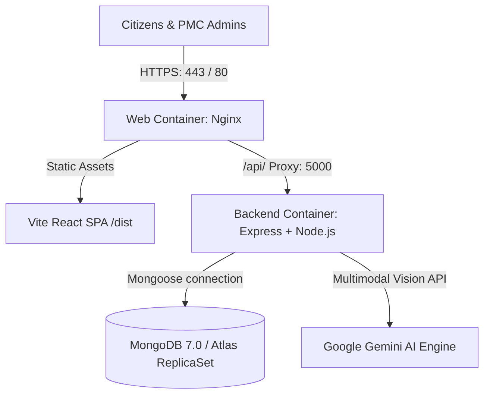

# CivicAI PMC — Production Deployment & CI/CD Guide

This document describes the containerization, continuous integration, continuous delivery (CI/CD), and cloud deployment architecture for **CivicAI PMC** (Issue #10).

---

## 1. Architecture Overview

CivicAI uses a modern containerized micro-architecture designed for reliability, scalability, and security:



### Key Components:
1. **Frontend / Web Container (`apps/frontend/Dockerfile` & `apps/web/Dockerfile`):**
   - Multi-stage build compiling Vite React application into production static artifacts.
   - Served by ultra-lightweight Alpine Nginx with Gzip compression, strict security headers, static asset caching, and SPA fallback (`try_files $uri $uri/ /index.html`).
   - Reverse-proxies all `/api/` traffic to the backend container.
   - Built-in `/healthz` endpoint for uptime monitoring.

2. **Backend API Container (`apps/backend/Dockerfile`):**
   - Multi-stage build compiling TypeScript with strict type checking into optimized JavaScript.
   - Runs as a non-privileged user (`node`) on Alpine Linux for container hardening.
   - Built-in container healthcheck pinging `GET /api/v1/health` every 30 seconds.

3. **Database:**
   - Supported with local containerized MongoDB 7.0 via `docker-compose.prod.yml` or production-grade MongoDB Atlas replica sets.

---

## 2. Docker & Local Production Deployment

To run the complete production-grade stack locally using Docker:

### Prerequisites:
- Docker Engine 24+ and Docker Compose v2+ installed.

### Step 1: Clone and Configure Environment
Copy `.env.example` or create `.env`:
```bash
cp apps/backend/.env.example apps/backend/.env
```

### Step 2: Build and Launch Containers
```bash
docker compose -f docker-compose.prod.yml up --build -d
```

### Step 3: Verify Running Services
```bash
# Check container status and health
docker compose -f docker-compose.prod.yml ps

# View backend logs
docker compose -f docker-compose.prod.yml logs -f backend

# View web frontend logs
docker compose -f docker-compose.prod.yml logs -f web
```

### Step 4: Health Check Verification
```bash
# Verify backend health
curl -f http://localhost:5000/api/v1/health

# Verify web server health
curl -f http://localhost/healthz
```

---

## 3. Production Environment Secrets

Configure these environment variables in your cloud hosting provider's Secret Manager (Railway / Render / Fly.io / AWS):

| Variable | Description | Production Example |
|---|---|---|
| `NODE_ENV` | Application environment | `production` |
| `PORT` | Backend listen port | `5000` |
| `MONGO_URI` | MongoDB connection URI | `mongodb+srv://<user>:<password>@cluster.pmc.mongodb.net/civicai_prod?retryWrites=true&w=majority` |
| `JWT_SECRET` | 256-bit cryptographically secure string (min 32 chars) | Generated with `openssl rand -base64 48` |
| `JWT_EXPIRES_IN` | Citizen session token expiry | `7d` |
| `OTP_HASH_SECRET` | Secret key for HMAC OTP verification | Generated with `openssl rand -base64 32` |
| `FRONTEND_URL` | Allowed CORS frontend origin | `https://civicai.pune.gov.in` |
| `GEMINI_API_KEY` | Google AI Studio multimodal API key | Production Gemini API key |
| `SMTP_HOST` | Production transactional mailer host | `smtp.sendgrid.net` or `smtp.gmail.com` |
| `SMTP_PORT` | SMTP TLS port | `587` |
| `SMTP_SECURE` | Secure connection boolean | `false` (for 587 STARTTLS) |
| `SMTP_USER` | SMTP username | `apikey` |
| `SMTP_PASSWORD` | SMTP password / API token | Production SMTP secret |
| `SMTP_FROM` | Official sender header | `"CivicAI Pune" <grievances@pmc.gov.in>` |

---

## 4. Automated CI/CD Pipelines

The repository features automated GitHub Actions workflows:

### A. Continuous Integration (`.github/workflows/ci.yml`)
Triggers automatically on every Pull Request and push to `main` and `dev`:
1. **Backend CI:** TypeScript typecheck (`tsc --noEmit`), build, and complete Vitest suite (including `tests/integration/flow.test.ts`).
2. **Mobile CI:** React Native / Expo typecheck.
3. **Web CI:** Vite production build and complete frontend component tests.

### B. Continuous Delivery (`.github/workflows/deploy.yml`)
Triggers on merge to `main` or via manual `workflow_dispatch`:
1. Logs into GitHub Container Registry (`ghcr.io`).
2. Builds and publishes Docker images:
   - `ghcr.io/pradnya1107/civic-ai-pmc-/backend:latest`
   - `ghcr.io/pradnya1107/civic-ai-pmc-/web:latest`
3. Optional cloud deployment hook (`DEPLOY_HOOK_URL`) triggers zero-downtime deployment on cloud host.

---

## 5. Cloud Platform Deployment Options

### Option A: Railway
1. Create a new Railway project and connect the GitHub repository.
2. Add **MongoDB** service from Railway marketplace.
3. Add **Backend** service, selecting `apps/backend/Dockerfile`. Set environment variables in Railway dashboard.
4. Add **Frontend** service, selecting `apps/frontend/Dockerfile`. Link backend URL.

### Option B: Render
1. Create a **Web Service** for backend using Docker environment.
2. Create a **Static Site** or Docker web service for frontend.
3. In Environment Settings, populate all production secrets.

### Option C: Fly.io
```bash
# Launch backend
fly launch --dockerfile apps/backend/Dockerfile --name civicai-backend

# Launch frontend
fly launch --dockerfile apps/frontend/Dockerfile --name civicai-web
```

---

## 6. Security & OWASP Compliance

1. **Dependency Vulnerability Audits:**
   Run regular security audits to ensure zero critical vulnerabilities:
   ```bash
   pnpm audit
   ```
2. **Container Security:**
   - Multi-stage Docker builds exclude devDependencies, test files, and source TypeScript files from runtime images.
   - Non-root user execution inside container.
   - Strict CORS policy and Helmet security headers enabled.
